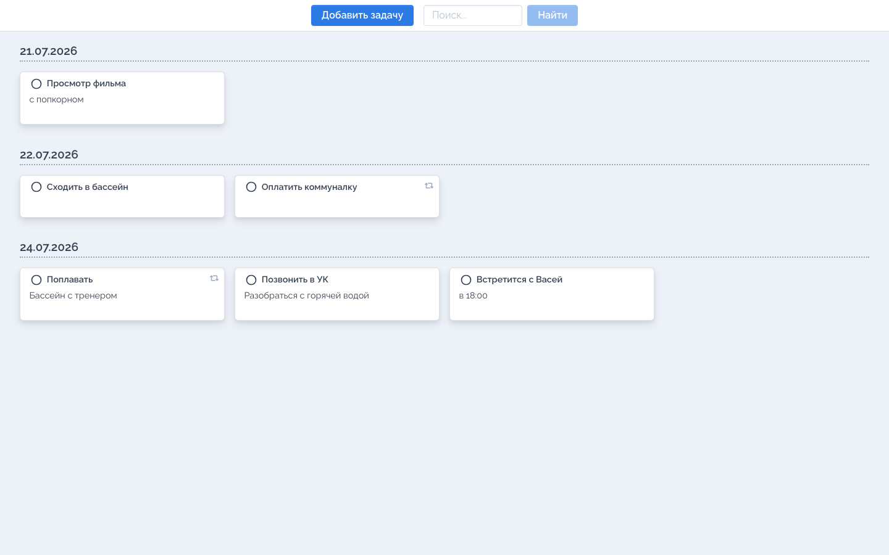
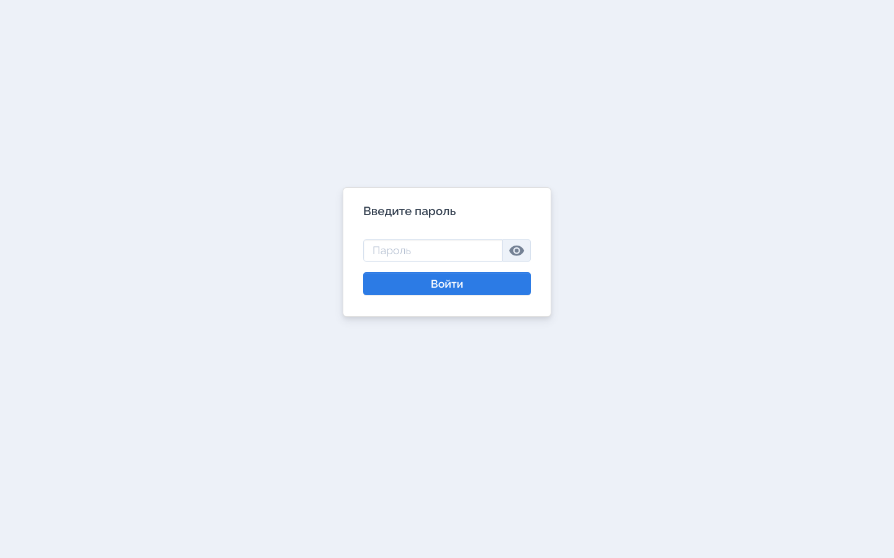

# Task Scheduler

[](https://github.com/amat-andre/task_scheduler/actions/workflows/tests.yml)


Веб-приложение для управления списком задач (to-do list) на Go: бэкенд с REST API, встроенный фронтенд, хранение данных в SQLite и поддержка повторяющихся задач с гибкими правилами.

## Скриншоты

| Список задач | Страница входа |
|--------------|----------------|
|  |  |

## Возможности

- создание, просмотр, редактирование и удаление задач;
- отметка задач как выполненных;
- повторяющиеся задачи с гибкими правилами (дни, недели, месяцы, годы);
- поиск задач по тексту (регистрозависимый) и по дате;
- JWT-аутентификация с middleware для проверки токена (включается при заданном пароле);
- хранение данных в SQLite — без внешних зависимостей и без CGO;
- запуск через Docker, база данных сохраняется на хосте через volume.

## Правила повторения задач

| Правило | Описание | Примеры |
|---------|----------|---------|
| `d <число>` | повтор через указанное число дней (максимум 400) | `d 1` — каждый день, `d 7` — каждую неделю, `d 60` — каждые 60 дней |
| `w <дни недели>` | повтор в указанные дни недели, где 1 — понедельник, 7 — воскресенье | `w 7` — в ближайшее воскресенье, `w 1,4,5` — в понедельник, четверг или пятницу |
| `m <дни> [месяцы]` | повтор в указанные дни месяца (1–31, `-1` — последний, `-2` — предпоследний день); месяцы (1–12) опциональны | `m 4` — 4-е число каждого месяца, `m -1` — последний день месяца, `m 1,-1 2,8` — первый и последний дни февраля и августа |
| `y` | ежегодный повтор | при выполнении дата переносится на год вперёд |

## Стек технологий

- **Бэкенд:** Go 1.25, `net/http` (роутинг через `http.ServeMux`)
- **База данных:** SQLite (`modernc.org/sqlite`), слой доступа — `sqlx`
- **Аутентификация:** JWT (`golang-jwt/jwt/v5`)
- **Фронтенд:** HTML / CSS / JS (статика в `web/`)
- **Инфраструктура:** Docker (multi-stage build на Alpine), GitHub Actions

## API

| Метод | Эндпоинт | Описание | Авторизация |
|-------|----------|----------|-------------|
| `POST` | `/api/signin` | получение JWT-токена по паролю | — |
| `GET` | `/api/nextdate` | расчёт следующей даты по правилу повторения | — |
| `GET` | `/api/tasks?search=` | список задач, поиск по тексту или дате | JWT |
| `GET` | `/api/task?id=` | получение задачи по идентификатору | JWT |
| `POST` | `/api/task` | создание задачи | JWT |
| `PUT` | `/api/task` | обновление задачи | JWT |
| `DELETE` | `/api/task?id=` | удаление задачи | JWT |
| `POST` | `/api/task/done?id=` | отметить задачу выполненной | JWT |

## Переменные окружения

| Переменная      | Описание                 | Значение по умолчанию |
| --------------- | ------------------------ | --------------------- |
| `TODO_PORT`     | порт запуска сервера     | `7540`                |
| `TODO_DBFILE`   | путь к файлу базы данных | `scheduler.db`        |
| `TODO_PASSWORD` | пароль для авторизации   | авторизация отключена |
| `JWT_SECRET`    | секретный ключ для JWT   | `super_very_secret`   |

Переменные можно задать через окружение или `.env`-файл.

## Быстрый старт

Требуется Go 1.24+.

```bash
git clone https://github.com/amat-andre/task_scheduler.git
cd task_scheduler
go run ./cmd
```

Запуск с авторизацией:

```bash
TODO_PASSWORD=12345 go run ./cmd
```

После запуска приложение доступно в браузере: http://localhost:7540
(если задан `TODO_PASSWORD`, произойдёт перенаправление на http://localhost:7540/login.html).

## Docker

Сборка образа:

```bash
docker build -t task-scheduler .
```

Запуск контейнера:

```bash
docker run -p 7540:7540 \
  -v "$(pwd)":/data \
  -e TODO_PORT=7540 \
  -e TODO_DBFILE=/data/scheduler.db \
  task-scheduler
```

- `-p 7540:7540` — проброс порта;
- `-v "$(pwd)":/data` — SQLite-база хранится на хосте и не теряется при перезапуске контейнера;
- при необходимости добавьте `-e TODO_PASSWORD=...` для включения аутентификации.

## Тестирование

1. Запустите сервер (см. выше).

2. Если включена авторизация, получите токен:

```bash
curl -X POST http://localhost:7540/api/signin \
  -H "Content-Type: application/json" \
  -d '{"password":"12345"}'
```

и подставьте его в `tests/settings.go`:

```go
var Token = "your_jwt_token"
```

3. При нестандартных порте или пути к БД укажите их там же:

```go
var Port = "{используемый порт}"
var DBFile = "../{используемый путь}"
```

4. Запустите тесты:

```bash
go test -v ./tests          # обычный запуск
go test -count=1 -v ./tests # без использования кэша
```

## Сборка

```bash
go build -o scheduler ./cmd
./scheduler
```

## Структура проекта

```
├── cmd
│   └── main.go            # точка входа приложения
├── internal
│   ├── api                # регистрация API-маршрутов
│   ├── auth               # JWT-аутентификация
│   ├── config             # загрузка конфигурации
│   ├── db                 # инициализация БД и SQL-запросы
│   ├── handlers           # HTTP-обработчики
│   ├── helpers            # вспомогательные функции
│   ├── middleware         # middleware авторизации
│   ├── server             # конфигурация и запуск HTTP-сервера
│   └── service            # бизнес-логика (повторения, даты)
├── tests                  # автотесты проекта
├── web                    # фронтенд (HTML/CSS/JS)
├── docs/screenshots       # скриншоты для README
├── Dockerfile             # сборка Docker-образа
└── scheduler.db           # база данных SQLite
```
